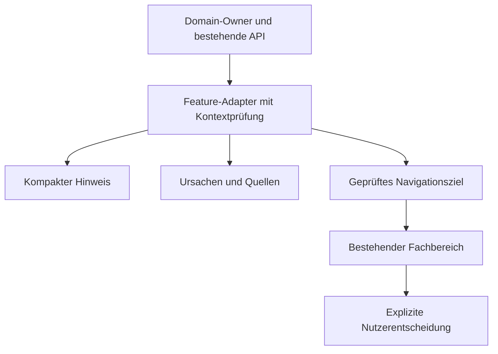

# Fachlicher Hinweisvertrag — Entwurf

[Übersicht](README.md) · [Inventur](inventory.md) · [TypeScript](contracts.ts)

## 1. Zuständigkeit und Datenfluss

Ein Hinweis ist eine **Darstellung vorhandener, belegter Fachinformationen**.
Er ist kein neuer Domainstatus, kein Alarmdatensatz und keine Finanzberechnung.
Der Domain-Owner entscheidet weiterhin über Berechenbarkeit, Zulässigkeit,
Quellenqualifikation und Recovery. Der Adapter im jeweiligen Feature ordnet
diese Tatsachen einem freigegebenen Text und Darstellungstyp zu. Gemeinsame
Komponenten zeigen das Ergebnis ohne eigene Fachentscheidungen.

Der gemeinsame API-Fehlervertrag bleibt `code`, `message`, `details`, `timestamp`
aus [exceptions/handlers.py](../../../backend/app/core/exceptions/handlers.py) und
[ApiErrorResponse](../../../frontend/src/features/market/types/api.ts).
`MarketApiError` und `MarketTransportError` aus dem bestehenden
[HTTP-Client](../../../frontend/src/features/market/services/http.ts) bleiben
unterscheidbar. Ein vorhandener `NOT_FOUND`-, `CONFLICT`- oder `VALIDATION_ERROR`-
Code rechtfertigt ohne weitere Fakten keine Diagnose „historische Quelle fehlt“.
Freitext wird niemals nach Wörtern wie „error“, „missing“ oder „alt“ klassifiziert.

## 2. Inhalt einer Meldung

| Feldgruppe | Verpflichtung und Bedeutung |
| --- | --- |
| Identität | Stabile Katalogreferenz und Hinweis-ID; Owner, Objektart/-ID, Zweck, belegte Ursache bzw. Statusdimension und relevante historische Version/Quellenidentität. Technische IDs stehen in Details. |
| Kontext | Workspace aus vertrauenswürdigem Requestkontext, ausgewähltes Objekt, Version/Pins, Berichtfilter und Basis-ID, soweit anwendbar. Kein Workspace aus einem unkontrollierten Link. |
| Zustand | Originales DTO/Read-Model mit benannten Feldern; gleiche Codes verschiedener Owner bleiben getrennt. Keine frei erfundene zusätzliche Fachstatusliste. |
| Ursache | Konkreter Domain-Code/Reason und verständliche Erklärung; `unbekannt` ausdrücklich zulässig, wenn der Vertrag keine Ursache liefert. |
| Auswirkung | Welche Anzeige, Berechnung oder konkrete Aktion eingeschränkt ist; zusätzlich was weiter möglich ist, wenn dies fachlich belegt ist. Kein pauschales „Trading blockiert“. |
| Herkunft | Bestehende Evidenz-, Ausführungs-, Listing-, Provider-, Modell- und Versionsreferenzen unverändert. Quellenlink nur bei sicherem vorhandenem Ziel. |
| Zeit | Fachliche Originalzeit, historische Gültigkeit, Zeitpunkt der Prüfung und ggf. Zeitpunkt des fehlgeschlagenen Abrufs getrennt. Unbekannte Zeiten nicht durch `Date.now()` ersetzen. |
| Automatik | Belegte Auflösung/übernommener Resolverbefund oder zuständiger geplanter Retry; keine neue Ableitung durch UX-3. |
| Nutzerbedarf | `keiner`, `optional prüfen` oder `erforderliche Entscheidung` mit konkret benannter Voraussetzung. Erforderlich immer relativ zu einer gewünschten Aktion. |
| Navigation | Exaktes geprüftes Objektziel oder ausdrücklich fehlende Zielunterstützung. Ein nicht vorhandener Deep-Link wird nicht erzeugt. |
| Behebung | Aktiver Zustand, belegte Auflösung, historisches Ereignis oder nicht beurteilbarer Vergleich. Ein verschwundener Datensatz ist kein Erfolgsbeleg. |

`contracts.ts` stellt diese Angaben als Vorschlag für unveränderliche View-Props
dar. Die unveränderten API-Typen werden wiederverwendet. Nicht jeder bestehende
Reader liefert bereits alle Angaben: fehlende Ursache, Versionsreferenz oder
Prüfzeit bleibt `null`/nicht beurteilbar und wird als Integrationslücke dokumentiert.
Es entstehen keine neuen Pflichtfelder für Nutzer.

## 3. Fünf Hinweisarten

| Art | Belegbarer Auslöser | Beispiel | Kein zulässiger Schluss |
| --- | --- | --- | --- |
| Information | Relevanter regulärer Zustand ohne notwendigen Eingriff | Journalentwurf vorhanden; Nachbeobachtung läuft; keine Verkäufe in der Periode. | `EMPTY`, `DRAFT`, deaktivierter optionaler Dienst oder historischer Storno seien Fehler. |
| Erfolg | Abgeschlossene Operation mit erfolgreicher Antwort bzw. fachlich bestätigtem neuem Zustand | Explizite Korrektur bestätigt; qualifizierter neuer Read belegt wieder verwendbare Daten. | Toast nach bloßem Klick, HTTP 200 mit unbrauchbarem Inhalt oder laufender Abruf. |
| Warnung | Konkrete Einschränkung bei verbleibender Nutzbarkeit | Bericht `PARTIAL`, fehlender Währungsnachweis eines Verkaufs, tatsächlich veralteter Kurs. | Jede indikative bzw. `LAST_AVAILABLE`-Bewertung sei unbrauchbar. |
| Blocker | Benannte Aktion/Berechnung aufgrund belegter Voraussetzung nicht zulässig | `INELIGIBLE`-Produkt auswählen; vollständigen Gesamtwert berechnen, obwohl der Owner `PARTIAL` und `total=null` liefert; historische Version nicht lesbar. | Ein Warnhinweis blockiere den ganzen Arbeitsbereich oder `NOT_EVALUABLE` sperre jede begründete Auswahl. |
| Fehler | Tatsächlich fehlgeschlagener fachlicher oder technischer Vorgang | Quellen-GET schlägt fehl; Providerabruf gescheitert; Buchung durch serverseitige Prüfung abgewiesen. | Ein normaler Leerdatenzustand oder laufender Retry sei ein gescheiterter Vorgang. |

Information und Erfolg begründen für sich keinen erforderlichen Nutzereingriff.
Ein Adapter darf `information` nicht mit `required-for-operation` kombinieren.
Die typisierte Darstellungspriorität unterstützt diese Grenze; die vollständige
fachliche Konsistenz bleibt zusätzlich eine Laufzeitinvariante des Adapters.

Eine Ursache kann verschiedene **Auswirkungen** haben, aber wird nicht als zwei
identische Warnbanner ausgegeben. Beispiel: fehlende Kaufwährung ist eine Warnung
in der Liste und begründet die nicht mögliche Bruttoberechnung in deren Detail.
Beim explizit angeforderten gesperrten Schritt wird die konkrete Blockade erklärt.
Fehler und Blockade können gemeinsam vorliegen: der fehlgeschlagene Vorgang ist
das Ereignis, die unerfüllte Voraussetzung die aktuelle Einschränkung.

`AlertSeverity`, `OperationalPriority`, `PositionAttentionState`, Finanzstatus,
Jobstatus und diese Präsentationsarten werden **nicht gleichgesetzt**. Ein
Stop-/Zielalert bleibt die fachliche Meldung seines Owners; UX-3 fügt keine
Handelsempfehlung hinzu.

## 4. Nachvollziehbare Priorität

Priorität ist Darstellung, getrennt von Schwere und Fachstatus. Sortierschlüssel:

1. Nachweislich blockierte konkrete Aktion oder Berechnung.
2. Tatsächlich notwendige Nutzerentscheidung im aktuellen Arbeitskontext.
3. Relevante Warnung oder fehlgeschlagener Vorgang mit offener Auswirkung.
4. Relevante Information über eingeschränkte Datenqualität ohne höherrangige Auswirkung.
5. Reguläre Information und belegter Erfolg.

Innerhalb einer Stufe: direkter Bezug zur gerade gewählten Aufgabe, anschließend
belegte Verschlechterung/neues Problem vor unverändertem Problem, dann stabile
Owner-Reihenfolge und Hinweis-ID. Ein fehlender Zeitpunkt oder fehlende
Vergleichsbasis erzeugt keine erfundene Dringlichkeit. Keine frei gesetzten
Minuten-, Kursalter-, Risikoscore- oder Fehleranzahlgrenzen. Die bloße Zahl der
Wiederholungen erhöht die fachliche Schwere nicht.

Der vorhandene Arbeitsbereich sortiert `ACTION`, `REVIEW`, `BLOCKED` und darin
Positionsalerts/Datenprobleme; siehe
[prioritization.py](../../../backend/app/features/operational_workspace/service/prioritization.py).
UX-3 ändert diese globale Reihenfolge in diesem Schnitt nicht. Der Vorschlag
gilt zunächst für Hinweisgruppen; die künftige Einordnung in den gemeinsamen
Arbeitsbereich muss mit UX-2 und dessen bestehender Aufgabenprojektion erfolgen.

## 5. Automatisch lösen, bevor eine Eingabe verlangt wird

| Fall | Sicher automatisch möglich | Wann ein Mensch nötig bleibt |
| --- | --- | --- |
| Historische Währung | `ExecutionCurrencyResolution` des vorhandenen `execution-currency-v3`-Resolvers verwenden; Evidence- und Confirmation-Referenzen mitanzeigen; dieselbe Erkenntnis in Position/Performance nutzen. | Nachweis fehlt, widerspricht sich oder reicht zeitlich nicht. Vorhandene Quellen im bestehenden Owner-Editor öffnen; nur nötige explizite Bestätigung/Korrektur. Niemals `USER_CONFIRMED` aus einem Read erzeugen. |
| Aktueller verwendbarer Kurs | Neuen qualifizierten Owner-Befund anzeigen; die aktuelle Kurswarnung derselben Dimension entfällt. Originalzeit, Quelle und Preisart übernehmen. | Tatsächlich fehlende Zuordnung/Zugangsvoraussetzung prüfen. Ein fälliger oder gedrosselter Retry ist üblicherweise Aufgabe des bestehenden Schedulers. |
| Erhaltener Altkurs | Originalwert und Originalzeiten sichtbar halten; `retained_quote` und Frische getrennt erläutern. | Nur wenn der Owner einen notwendigen Eingriff belegt. „Jetzt erneut abrufen“ darf weder Sperren umgehen noch zusätzliche Provideraufrufe beim Rendern erzeugen. |
| Performance | Vorhandene Ausführungen, Belege und Bericht-Basis verknüpfen; `total`, `subtotal`, `status`, `counts` unverändert darstellen. | Fehlende oder widersprüchliche Ausgangsbelege prüfen. Der Nutzer soll keine nicht belegbare Währung oder Kostenbasis schätzen. |
| Journal/Lessons | Vorhandene Quellenversionen und Currentness zum Lesen bereitstellen. | Bewerten, Quelle neu binden, finalisieren, Materialisierung anstoßen, Lesson-Review entscheiden und Modell freigeben bleiben explizite Commands beim Owner. |
| Governance | Genehmigte Version und tatsächlich aktivierte Version getrennt lesen. | Approval und Runtime-Aktivierung bleiben verschiedene ausdrückliche Entscheidungen. Kein automatischer Wechsel bei Hinweisöffnung. |

„Automatische Lösung verfügbar“ ist nur zulässig, wenn der Owner sie tatsächlich
liefert. UX-3 startet keine neue Quellenrecherche, keinen Hintergrund-Write und
keinen zusätzlichen Providerabruf. Geplante Folgefähigkeit wird als Vorschlag
angezeigt, niemals als erledigte Automatik.

## 6. Identität, Wiederholung und Lebenszyklus

### Identität und Zusammenfassung

Stabile Identität = Owner + Katalogregel + Objektbezug + Zweck + relevante
Quellen-/Versionsdimension. Für Refreshchecks zusätzlich `JOB`/`SOURCE`, Job,
Source, Listing und `identity_key`; für Berichte Berichtart, Filter und
betroffene Ausführungen. Gleiche Texte sind kein Identitätsbeweis.

Polling-Zeit, übersetzter Titel, Schweregrad, Count und Renderposition gehören
nicht in die Identität. Die **Vergleichsversion** eines Reads und die lokale
Requestgeneration sind getrennt von dieser Identität. Auch `basis.id` gehört in
den validierten Berichtskontext und Vergleichsnachweis, nicht in den stabilen
Schlüssel einer unveränderten Ursache: eine Korrektur eines anderen Trades soll
keine neue Alarmidentität erzeugen. Bei einer neuen Berichtsgrundlage darf
derselbe fachliche Grund weiter bestehen, seine Beträge und Belege dürfen aber
nicht aus der alten Grundlage übernommen werden. Ausdrücklich gepinnte historische
Snapshots bleiben mit ihrer relevanten Version identifizierbar.

- Ein und dieselbe Ursache am selben Objekt erscheint pro Oberfläche einmal.
  Die Zusammenfassung referenziert das Detail statt einen zweiten Banner zu erzeugen.
- Mehrere betroffene Ausführungen dürfen eine Sammelzeile bilden. Der Count zählt
  eindeutige Objekte, nicht Polls; jedes Objekt und seine Quelle bleiben erreichbar.
- Unabhängige Ursachen und unterschiedliche Source-Identitäten bleiben getrennt.
  Ein Providerproblem und eine Kostenbasislücke werden nicht verschmolzen.
- Vorhandene persistierte Alert-Deduplizierung bleibt beim Alert-Owner. Die
  Anzeigezusammenfassung quittiert, löscht oder invalidiert keinen Alert.
- Ein Aufklappzustand darf lokal gemerkt werden; „gesehen“ bedeutet nicht „behoben“.
  Keine neue globale Hinweisdatenbank oder persistente Wegklick-Quittierung.

### Änderungsarten

| Änderungsart | Erforderliche Grundlage | Anzeigeverhalten |
| --- | --- | --- |
| Neues Problem | Erstes Auftreten gegenüber passendem gültigem Vergleichssnapshot oder Owner-Episode | Einmal ankündigen; nach Browserneustart ohne Historie nur „aktuell festgestellt“. |
| Unverändert | Gleicher fachlicher Kontext, gleiche Ursache und Auswirkung | Bestehenden Hinweis aktualisieren, keine erneute Live-Ankündigung. |
| Verschlechterung | Owner belegt neue Einschränkung oder blockierte Funktion | Konkrete zusätzliche Auswirkung benennen; keine Eskalation allein nach Timer. |
| Wiederherstellung | Positiver fachlicher Nachweis für dieselbe Ursache und Identität | Aktiven Hinweis ersetzen; optional einmalige ruhige Erfolgsanzeige, Details erhalten. |
| Historisches Ereignis | Explizit gewählte historische Version oder abgeschlossene Owner-Episode | Zeitpunkt und damaligen Kontext anzeigen; keine aktuelle Handlungsaufforderung daraus ableiten. |
| Nicht vergleichbar | Erstabruf, unvollständiger Read, Identitätswechsel, Prozessneustart ohne Historie | Keine Behauptung „neu“, „verschlechtert“ oder „wiederhergestellt“. |

### Kursqualität und Provider-Recovery

Die vorhandene
[Refresh-Diagnostik](../../../backend/app/features/market_data/service/refresh_diagnostics.py)
ist maßgeblich. `qualified_success`, `recovered_at`, `observed_in_latest_run`,
`waiting`, Quotequalität und Source-Identität werden nicht im Frontend neu berechnet.
Bei gleichem Objekt können daher gleichzeitig gelten:

- Ein anderer zulässiger Kurs ist wieder verwendbar: die **aktuelle
  Kursqualitätswarnung** ist erledigt.
- Der letzte Abruf einer bestimmten Quelle ist weiterhin gescheitert: die
  **Providerdiagnose** ist nicht wiederhergestellt.
- Eine historische Fehlerfolge bleibt in Details sichtbar und ist nicht das
  aktuelle Gesamturteil über die Position.

Ein erfolgreicher JOB beendet keine unbeobachtete SOURCE-Fehlerfolge; HTTP 200
mit leerer, veralteter oder zeitlich unbelegter Antwort beweist keinen
qualifizierten Erfolg. Im aktuellen Owner setzt ein neuer echter Fehler
`recovered_at` zurück. Deshalb immer den vollständigen neuesten Snapshot lesen;
ein Recoveryzeitpunkt aus einer älteren Antwort darf eine aktuelle Fehlerfolge
nicht überdecken. `qualified_success` belegt die vom Owner definierte
Wiederherstellung des Checks, aber nicht automatisch einen neuen HTTP-Kontakt:
„Provider wieder erreichbar“ setzt zusätzlich `provider_reachable=true` voraus.
Prozesslokal verlorene Diagnostik ist keine Recovery. Diese Regeln werden im
Fachadapter geprüft; die gemeinsame Karte erhält nur das belegte Ergebnis samt Nachweis.

## 7. Objektwechsel und verspätete Antworten

Ein Hinweis darf ausschließlich auf einen validierten Kontextsnapshot reagieren.
Der Kontext umfasst mindestens Workspace, Objektart/-ID, Zweck, ausgewählte
Versionen und Requestgeneration; bei Performance zusätzlich alle Filter,
Berichtdefinition und `basis.id`. Bei Quellenchecks sind Listing und
`identity_key` maßgeblich.

1. Kontextwechsel erhöht die Generation und beendet/ignoriert bisherige Requests.
2. Hinweis, Fehler, Erfolg, Details, Aktionen und Pending-Entscheidung werden
   synchron für den alten Kontext ungültig. Nur die Daten zu leeren reicht nicht.
3. Nach jeder Antwort Identität **und** Generation sowie vorhandene
   Versions-/Berichtvalidatoren prüfen. `AbortController` allein schützt nicht
   vor bereits aufgelösten Promises und A→B→A.
4. Ein älterer Refresh desselben Objekts darf einen neueren nicht überschreiben.
   Kein „erfolgreich“ im `finally`, keine Erfolgsanzeige auf unpassender Antwort.
5. Fehler eines Detailreads ist lokal; andere belegte Sektionen bleiben lesbar.
   Fehlende Daten aus einem misslungenen Read sind nicht fachlich `MISSING`.
6. Vor Klick und im Zielfachbereich den aktuellen Kontext prüfen. Nach
   Mutationen besitzt allein der Owner den Versions-/Idempotenzschutz.

Vorhandene Muster:
[loadPositionSignals](../../../frontend/src/features/operational_workspace/services/loadPositionSignals.ts),
[sourceView](../../../frontend/src/features/trade/services/sourceView.ts),
[Performance-Kontext](../../../frontend/src/features/performance/services/performanceReportContext.ts),
[Abschlussbericht-Kontext](../../../frontend/src/features/performance/services/closedReportContext.ts),
[planViewContext](../../../frontend/src/features/trade_plan/services/planViewContext.ts).
Diese Verträge werden wiederverwendet und nicht durch einen globalen Eventbus ersetzt.

## 8. Unbekannte Codes und offene Entscheidungen

Ein unbekannter **Fehlercode einer gescheiterten Operation** wird als Fehler mit
bekanntem Vorgang und begrenzter Auswirkung gezeigt; Ursache ausdrücklich noch
nicht aufgeschlüsselt. Ein unbekannter Status bei erfolgreichem Read erhält
keine erfundene Blockade und kein grünes „alles in Ordnung“. Der Adapter meldet
„Status derzeit nicht einordenbar“ mit sicherem Leseziel, Originalreferenz in
Details und ohne Mutation. Ein bereits belegtes `usable=false` bleibt erhalten.

Neue fachliche Ursachen, Schwellwerte, Pflichtfreigaben oder Zulässigkeitsregeln
brauchen eine Entscheidung des Domain-Owners. Die konkrete Liste steht in
[Integration und Folgearbeiten](integration-and-rollout.md); Texte dürfen diese
Lücken nicht durch plausibel klingende Vermutungen schließen.
