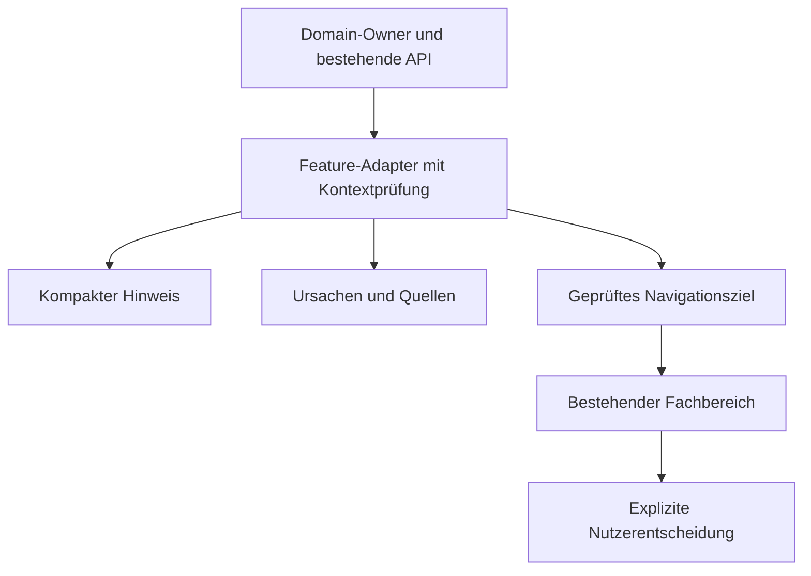

# Fachlicher Hinweisvertrag

[Übersicht](README.md) · [Inventur](inventory.md) · [TypeScript](contracts.ts)

Dieser eine Vertrag konsolidiert die Grundlage aus #314 mit den verpflichtenden
Präzisierungen aus #315 gemäß der
[Masterentscheidung Phase 1](../../coordination/UX_SHARED_CONTRACTS.md#kanonischer-ux3-hinweisvertrag--masterentscheidung-phase-1).
Die Konsolidierung wurde in #314 integriert. Der gesonderte, konkret abgegrenzte
[B1/F1-Schnitt](../../implementation/UX3_B1_CURRENCY_NOTICE.md) implementiert
die reine Shared-Darstellung und einen Performance-Adapter. Dokumentationstypen
sind kein Produktimport und kein Nachweis einer bereits erfolgten fachlichen UI-Abnahme.

## 1. Zuständigkeit und Datenfluss

Ein Hinweis ist eine **Darstellung vorhandener, belegter Fachinformationen**.
Er ist kein neuer Domainstatus, kein Alarmdatensatz und keine Finanzberechnung.
Der Domain-Owner entscheidet weiterhin über Berechenbarkeit, Zulässigkeit,
Quellenqualifikation und Recovery. Der Adapter im jeweiligen Feature ordnet
diese Tatsachen einem freigegebenen Text und Darstellungstyp zu. Gemeinsame
Komponenten zeigen das Ergebnis ohne eigene Fachentscheidungen.

Der gemeinsame API-Fehlervertrag bleibt `code`, `message`, `details`, `timestamp`
aus [exceptions/handlers.py](../../../backend/app/core/exceptions/handlers.py) und
[ApiErrorResponse](../../../frontend/src/features/market/types/api.ts).
`MarketApiError` und `MarketTransportError` aus dem bestehenden
[HTTP-Client](../../../frontend/src/features/market/services/http.ts) bleiben
unterscheidbar. Ein vorhandener `NOT_FOUND`-, `CONFLICT`- oder `VALIDATION_ERROR`-
Code rechtfertigt ohne weitere Fakten keine Diagnose „historische Quelle fehlt“.
Freitext wird niemals nach Wörtern wie „error“, „missing“ oder „alt“ klassifiziert.

Ein strukturierter API-Fehler ist keine allgemeine Garantie, dass ein Write
nichts gespeichert hat. Insbesondere HTTP 5xx, eine verlorene Antwort oder eine
nicht zuordenbare Erfolgsantwort bleiben nach der bestehenden Ownerklassifikation
ungeklärt. `ApiFailureNotice` bindet deshalb den Originalfehler an diese vorhandene
Operationsaussage; der gemeinsame Renderer klassifiziert weder HTTP-Status noch
Retryfähigkeit selbst. Die Regeln zu Receipt und Readback stehen in Abschnitt 5.

UX-2 besitzt Hostplatzierung, Navigation, Hostfokus, Formulardauer und Readback/
Invalidierung. UX-1 liefert vorhandene Eingabe-/Quellenableitung, UX-4 visualisiert
die Datenqualität. UX-3 verantwortet ihre verständliche Sprache, Details und die
Ansage innerhalb der vereinbarten Fläche. Fachliche Bedeutung bleibt beim Owner.

## 2. Inhalt einer Meldung

| Feldgruppe | Verpflichtung und Bedeutung |
| --- | --- |
| Identität | `catalogRule` und stabile Hinweis-ID; Owner, echte Objekt-/Quellidentität soweit bekannt, Zweck und ursächlich relevante Version/Episode. `subject` unterscheidet bekannte Objektidentität von belegtem Vorgangs-/Formular-/Elternkontext ohne neue Objekt-ID. Technische IDs stehen in Details. |
| Kontext | Workspace aus vertrauenswürdigem Requestkontext, ausgewähltes Objekt, Version/Pins, Berichtfilter und Basis-ID, soweit anwendbar. Kein Workspace aus einem unkontrollierten Link. |
| Zustand | `evidence` und `authority` binden originales DTO/Read-Model und Owner; gleiche Codes verschiedener Owner bleiben getrennt. Keine frei erfundene zusätzliche Fachstatusliste. |
| Ursache | Konkreter Domain-Code/Reason und verständliche Erklärung; `unbekannt` ausdrücklich zulässig, wenn der Vertrag keine Ursache liefert. |
| Auswirkung | Welche Anzeige, Berechnung oder konkrete Aktion eingeschränkt ist; zusätzlich was weiter möglich ist, wenn dies fachlich belegt ist. Kein pauschales „Trading blockiert“. |
| Herkunft | Bestehende Evidenz-, Ausführungs-, Listing-, Provider-, Modell- und Versionsreferenzen unverändert. Quellenlink nur bei sicherem vorhandenem Ziel. |
| Zeit | Fachliche Originalzeit, historische Gültigkeit, Zeitpunkt der Prüfung und ggf. Zeitpunkt des fehlgeschlagenen Abrufs getrennt. Unbekannte Zeiten nicht durch `Date.now()` ersetzen. |
| Automatik | `automatic`: belegte Auflösung/übernommener Resolverbefund oder zuständiger geplanter Retry; keine neue Ableitung durch UX-3. |
| Nutzerbedarf | `userNeed`: `none`, `optional-inspection` oder `required-for-operation` mit konkret benannter Voraussetzung. Erforderlich immer relativ zu einer gewünschten Aktion. |
| Navigation | `actions`: exaktes geprüftes Objektziel oder ausdrücklich fehlende Zielunterstützung. `read` und `open-decision` navigieren ausschließlich; Readerbuttons, Verwerfen und Commands bleiben beim Owner. |
| Behebung | `lifecycle`: aktiver Zustand, belegte Auflösung, historisches Ereignis oder nicht beurteilbarer Vergleich. Nur Darstellungsprojektion aus Ownerfakten; ein verschwundener Datensatz ist kein Erfolgsbeleg. |

`contracts.ts` stellt diese Angaben als vollständigen unveränderlichen
Ownervertrag dar. Die reine Projektion `NoticeView` ist in
[`shared/notices/types.ts`](../../../frontend/src/shared/notices/types.ts)
einmalig implementiert; der Dokumentvertrag importiert und erweitert sie um
Kontext, Originalevidence und Lifecycle. Der B1/F1-Renderer erhält nur die
präsentierbaren Felder. Die Prüfung von Item-/Quellenidentität, Filter und Basis
liegt beim Performance-Adapter, Requestgeneration und Abortschutz beim bestehenden
Host. Nicht vorhandene generische Workspace-/Generationswerte werden nicht erfunden.

Die unveränderten API-Typen werden wiederverwendet. Nicht jeder bestehende Reader
liefert bereits alle Angaben: fehlende Ursache, Versionsreferenz oder Prüfzeit
bleibt `null`/nicht beurteilbar und wird als Integrationslücke dokumentiert.
Es entstehen keine neuen Pflichtfelder für Nutzer oder ein zweites Hinweisstatusmodell.

Vor Create oder nach unklarem Create-Ergebnis darf keine UUID erfunden werden.
Ein bekannter Elterntrade oder Vorgang kann den Hinweis tragen, aber kein Link
auf ein unbestätigtes neues Objekt entstehen. Der Titel nennt vorhandenen Namen,
WKN/ISIN, Buchungsart und Datum; fehlt das Label, etwa „Produktname nicht verfügbar“
oder „Betroffener Trade“ mit belegtem Kontext. Kein zusätzlicher Stammdatenread pro
Hinweis und keine UUID als alleiniger Primärtext.

Laden, ungeprüft, bestätigt leer, Fehler und **belegte fehlende Berechtigung** sind
verschieden. HTTP 404 oder ein Netzwerkausfall beweist keine fehlende Benutzerrolle;
Providerzugang ist ebenfalls nicht automatisch Benutzerberechtigung. Unbekannte
Originalcodes bleiben sekundäre Diagnose. Rohe Exceptions, HTML, Providerantworten
und beliebige `details.context`-Werte werden nicht ungefiltert gerendert; nur bekannte
nutzbare Detailfelder gehören in die Ansicht.

## 3. Fünf Hinweisarten

| Art | Belegbarer Auslöser | Beispiel | Kein zulässiger Schluss |
| --- | --- | --- | --- |
| Information | Relevanter regulärer Zustand ohne notwendigen Eingriff | Journalentwurf vorhanden; Nachbeobachtung läuft; keine Verkäufe in der Periode. | `EMPTY`, `DRAFT`, deaktivierter optionaler Dienst oder historischer Storno seien Fehler. |
| Erfolg | Abgeschlossene Operation mit erfolgreicher Antwort bzw. fachlich bestätigtem neuem Zustand | Explizite Korrektur bestätigt; qualifizierter neuer Read belegt wieder verwendbare Daten. | Toast nach bloßem Klick, HTTP 200 mit unbrauchbarem Inhalt oder laufender Abruf. |
| Warnung | Konkrete Einschränkung bei verbleibender Nutzbarkeit | Bericht `PARTIAL`, fehlender Währungsnachweis eines Verkaufs, tatsächlich veralteter Kurs. | Jede indikative bzw. `LAST_AVAILABLE`-Bewertung sei unbrauchbar. |
| Blocker | Benannte Aktion/Berechnung aufgrund belegter Voraussetzung nicht zulässig | `INELIGIBLE`-Produkt auswählen; vollständigen Gesamtwert berechnen, obwohl der Owner `PARTIAL` und `total=null` liefert; historische Version nicht lesbar. | Ein Warnhinweis blockiere den ganzen Arbeitsbereich oder `NOT_EVALUABLE` sperre jede begründete Auswahl. |
| Fehler | Tatsächlich fehlgeschlagener fachlicher oder technischer Vorgang | Quellen-GET schlägt fehl; Providerabruf gescheitert; Buchung durch serverseitige Prüfung abgewiesen. | Transport-/Antwortfehler beweise eine fachliche Ablehnung des Writes; normaler Leerstand oder laufender Retry sei ein gescheiterter Vorgang. |

Information und Erfolg begründen für sich keinen erforderlichen Nutzereingriff.
Ein Adapter darf `information` nicht mit `required-for-operation` kombinieren.
Die typisierte Darstellungspriorität unterstützt diese Grenze; die vollständige
fachliche Konsistenz bleibt zusätzlich eine Laufzeitinvariante des Adapters.

Die sieben Familien aus der [vertieften Inventur](detail-inventory.md) ordnen
Inhalte, nicht zusätzliche Varianten eines Komponenten- oder Domainenum:

| Inventurfamilie | Zuordnung im einzigen Hinweisvertrag |
| --- | --- |
| Vorgangsblocker | `blocker` mit belegter konkreter Operation |
| Erforderliche Entscheidung | `userNeed=required-for-operation` und passende Art/Priorität; nie `information` |
| Fachlicher Hinweis | `warning` oder `information` entsprechend vorhandener Wirkung |
| Datenqualität / Aussagegrenze | `information`, `warning` oder `blocker` entsprechend konkreter Verwendung |
| Verarbeitung / technischer Fehler | Regulärer Fortschritt `information`; belegter fehlgeschlagener Vorgang `error`, unklarer Writeausgang ausdrücklich unklar |
| Quellen- / Kontextinformation | `information` mit exaktem historischen Bezug |
| Bestätigtes Ergebnis / Recovery | `success` mit passendem Ownernachweis; unabhängiger Readbackfehler bleibt sichtbar |

Eine Ursache kann verschiedene **Auswirkungen** haben, aber wird nicht als zwei
identische Warnbanner ausgegeben. Beispiel: fehlende Kaufwährung ist eine Warnung
in der Liste und begründet die nicht mögliche Bruttoberechnung in deren Detail.
Beim explizit angeforderten gesperrten Schritt wird die konkrete Blockade erklärt.
Fehler und Blockade können gemeinsam vorliegen: der fehlgeschlagene Vorgang ist
das Ereignis, die unerfüllte Voraussetzung die aktuelle Einschränkung.

`AlertSeverity`, `OperationalPriority`, `PositionAttentionState`, Finanzstatus,
Jobstatus und diese Präsentationsarten werden **nicht gleichgesetzt**. Ein
Stop-/Zielalert bleibt die fachliche Meldung seines Owners; UX-3 fügt keine
Handelsempfehlung hinzu.

## 4. Nachvollziehbare Priorität

Priorität ist Darstellung, getrennt von Schwere und Fachstatus. Sortierschlüssel:

1. Nachweislich blockierte konkrete Aktion oder Berechnung.
2. Tatsächlich notwendige Nutzerentscheidung im aktuellen Arbeitskontext.
3. Relevante Warnung oder fehlgeschlagener Vorgang mit offener Auswirkung.
4. Relevante Information über eingeschränkte Datenqualität ohne höherrangige Auswirkung.
5. Reguläre Information und belegter Erfolg.

Innerhalb einer Stufe: direkter Bezug zur gerade gewählten Aufgabe, anschließend
belegte Verschlechterung/neues Problem vor unverändertem Problem, dann stabile
Owner-Reihenfolge und Hinweis-ID. Ein fehlender Zeitpunkt oder fehlende
Vergleichsbasis erzeugt keine erfundene Dringlichkeit. Keine frei gesetzten
Minuten-, Kursalter-, Risikoscore- oder Fehleranzahlgrenzen. Die bloße Zahl der
Wiederholungen erhöht die fachliche Schwere nicht.

Der vorhandene Arbeitsbereich sortiert `ACTION`, `REVIEW`, `BLOCKED` und darin
Positionsalerts/Datenprobleme; siehe
[prioritization.py](../../../backend/app/features/operational_workspace/service/prioritization.py).
UX-3 ändert diese globale Reihenfolge in diesem Schnitt nicht. Der Vorschlag
gilt zunächst für Hinweisgruppen; die künftige Einordnung in den gemeinsamen
Arbeitsbereich muss mit UX-2 und dessen bestehender Aufgabenprojektion erfolgen.

## 5. Belegte Automatik und bewusste Owneraktionen

| Fall | Sicher automatisch möglich | Wann ein Mensch nötig bleibt |
| --- | --- | --- |
| Historische Währung | `ExecutionCurrencyResolution` des vorhandenen `execution-currency-v3`-Resolvers verwenden; Evidence- und Confirmation-Referenzen mitanzeigen; dieselbe Erkenntnis in Position/Performance nutzen. | Nachweis fehlt, widerspricht sich oder reicht zeitlich nicht. Vorhandene Quellen im bestehenden Owner-Editor öffnen; nur nötige explizite Bestätigung/Korrektur. Niemals `USER_CONFIRMED` aus einem Read erzeugen. |
| Aktueller verwendbarer Kurs | Neuen qualifizierten Owner-Befund anzeigen; die aktuelle Kurswarnung derselben Dimension entfällt. Originalzeit, Quelle und Preisart übernehmen. | Tatsächlich fehlende Zuordnung/Zugangsvoraussetzung prüfen. Ein fälliger oder gedrosselter Retry ist üblicherweise Aufgabe des bestehenden Schedulers. |
| Erhaltener Altkurs | Originalwert und Originalzeiten sichtbar halten; `retained_quote` und Frische getrennt erläutern. | Nur wenn der Owner einen notwendigen Eingriff belegt. „Jetzt erneut abrufen“ darf weder Sperren umgehen noch zusätzliche Provideraufrufe beim Rendern erzeugen. |
| Performance | Vorhandene Ausführungen, Belege und Bericht-Basis verknüpfen; `total`, `subtotal`, `status`, `counts` unverändert darstellen. | Fehlende oder widersprüchliche Ausgangsbelege prüfen. Der Nutzer soll keine nicht belegbare Währung oder Kostenbasis schätzen. |
| Journal/Lessons | Vorhandene Quellenversionen und Currentness zum Lesen bereitstellen. | Bewerten, Quelle neu binden, finalisieren, Materialisierung anstoßen und Lesson-Review entscheiden bleiben explizite Commands beim Owner. Ein gültiger vorhandener Draft bleibt nach Ownervertrag auch bei STALE/unbereiter Quelle speicherbar. |
| Governance | Genehmigte Version und tatsächlich aktivierte Version getrennt lesen. | Approval und Runtime-Aktivierung bleiben verschiedene ausdrückliche Entscheidungen. Kein automatischer Wechsel bei Hinweisöffnung. |

„Automatische Lösung verfügbar“ ist nur zulässig, wenn der Owner sie tatsächlich
liefert. UX-3 startet keine neue Quellenrecherche, keinen Hintergrund-Write und
keinen zusätzlichen Providerabruf. Geplante Folgefähigkeit wird als Vorschlag
angezeigt, niemals als erledigte Automatik.

### Writes, Wiederholung und Readback

| Vorhandener Ownerbefund | Verständliche Aussage | Zulässiger Benutzerweg |
| --- | --- | --- |
| Lesender Request fehlgeschlagen | „{Daten} konnten nicht geladen werden.“ | Benannten Reader für denselben Kontext erneut lesen; beim Host, außerhalb von `NoticeAction`. |
| Explizite fachliche Ablehnung | „{Vorgang} wurde abgewiesen: {belegter Grund}.“ | Vorhandenen Korrektur-/Konfliktweg nutzen; groben Code nicht durch Freitextheuristik verfeinern. |
| Writeantwort verloren, strukturierte HTTP 503 oder nicht sicher zuordenbare Antwort | „Das Ergebnis von {Vorgang} ist noch nicht bestätigt.“ | Nur die bestehende Ownerklärung: Readback oder dessen dokumentierter ausdrücklicher Retry. Kein neuer Key/Payload und keine allgemeine Replaygarantie. |
| Write durch passenden Receipt bestätigt, Readback fehlerhaft | „Gespeichert. Die aktualisierte Ansicht konnte noch nicht geladen werden.“ | Bestätigung erhalten, nur exakten Readback erneut lesen; den bestätigten Write nicht erneut senden. |
| Veraltete Version/Statebasis | „Die Grundlage hat sich geändert. Bitte den aktuellen Stand prüfen.“ | Vorhandenen Ownerkonfliktweg mit bewusster Prüfung/Bestätigung oder Abbrechen und Neuvorbereiten erhalten. Der Hinweis verwirft/rebindet selbst nichts. |
| Überholter Read nach Kontextwechsel | Keine neue Aussage zum aktuellen Objekt | Alte Antwort einschließlich Fehler/Erfolg verwerfen; keine fremde Recovery. |

[Journalbefehle](../../../frontend/src/features/learning/components/useTradeJournal.ts)
dürfen ausschließlich über ihren vorhandenen bewussten Retry denselben
eingefrorenen Trade, Actor, Payload und Idempotency-Key wiederverwenden. Ein
erfolgreicher GET oder lokales Verwerfen beendet Journal-Unknown nicht.
[Lesson-Erstellung](../../../frontend/src/features/learning/components/LessonDraftFromEvidence.tsx),
Governancevalidation, Approval und Aktivierung besitzen keine allgemeine solche
Garantie. Bestehende idempotente Lessonreview-Commands sind separat von Create
zu behandeln. Keine gemeinsame Retryengine und kein automatisches Nachsenden.
Auch innerhalb von Trade-Position gelten verschiedene Wege: Ein vorhandener
Currency-/Capture-Owner kann seinen eigenen identischen Retry erlauben;
ExecutionDates-Korrekturen verlangen bei Unknown ihren bestehenden Readback und
erneute Prüfung. Daraus folgt kein pauschaler POST-Retry für Buchungen.

### Unabhängige Governance- und Quellenbefunde

`GovernanceEvidence` trägt für Approval und Runtimeaktivierung jeweils den
eigenen Readzustand, Objekt-/Versionsbezug und vorhandenen Zeit-/Generationsbeleg.
Ungeprüft, laden, fehlgeschlagen und erfolgreich gelesen sind verschieden.
Erst ein erfolgreicher kontextgeprüfter Runtime-Read mit `current=null` belegt
„keine aktive Version“. Ein Fehler bei vorhandener Approval belegt das nicht;
ein gemeinsamer UI-Token macht die Reads nicht atomar. Eine Aktivierung für ein
fremdes Modell ist kein passender Nachweis.

APPROVED, neueste Version und aktive Runtimeversion bleiben getrennt. Ein
technisch erfolgreicher Validationlauf entscheidet keine fachliche
`CONTRADICTS`-Review. Beim Candidate überschreibt ein einzelner Runtime-Schritt
`COMPLETE` niemals das bestehende Gesamtguard `can_evaluate=false`; nach
Ablehnung kann der Owner Readiness neu lesen, aber keine Evaluation automatisch
wiederholen. Quellen:
[RuntimeActivationPanel](../../../frontend/src/features/model/components/RuntimeActivationPanel.tsx),
[LessonReviewPanel](../../../frontend/src/features/learning/components/LessonReviewPanel.tsx),
[CandidatePage](../../../frontend/src/features/candidate/pages/CandidatePage.tsx).

Die [Monitoringvertiefung](detail-inventory.md#8-monitoring) begrenzt weitere
Aussagen: Health OK qualifiziert nur seine Basiswert-Tagesdaten. Risiko-Metriken
NOT_EVALUABLE und Quotequalität LIMITED sind verschiedene Achsen; INITIALIZED
beweist keinen Trendbruch, SAME_OR_OLDER_SESSION keinen weiteren Bestätigungstag.
IV NOT_EVALUABLE ist weder IV=0 noch „niedriges Risiko“ und verlangt kein Schätzen
fehlender Annahmen. Bei nicht verfügbarer Attentionqualität bedeuten
`alert_level=null` und `attention_required=false` nicht NORMAL.
DYNAMIC_STOP_BREACHED bleibt die vorhandene lesende Projektion, kein neuer
persistierter Alert oder übernommener Brokerstop.

## 6. Identität, Wiederholung und Lebenszyklus

### Identität und Zusammenfassung

Stabile Identität = Owner + Katalogregel/Originalreason + Objektbezug + konkrete
Ursache + Operation/Aussagebereich + ursächlich relevante Version/Episode.
Für Refreshchecks zusätzlich `JOB`/`SOURCE`, Job,
Source, Listing und `identity_key`; für Berichte Berichtart, Filter und
betroffene Ausführungen. Gleiche Texte sind kein Identitätsbeweis.

Polling-Zeit, übersetzter Titel, Schweregrad, Count und Renderposition gehören
nicht in die Identität. Die **Vergleichsversion** eines Reads und die lokale
Requestgeneration sind getrennt von dieser Identität. Auch `basis.id` gehört in
den validierten Berichtskontext und Vergleichsnachweis, nicht in den stabilen
Schlüssel einer unveränderten Ursache: eine Korrektur eines anderen Trades soll
keine neue Alarmidentität erzeugen. Bei einer neuen Berichtsgrundlage darf
derselbe fachliche Grund weiter bestehen, seine Beträge und Belege dürfen aber
nicht aus der alten Grundlage übernommen werden. Ausdrücklich gepinnte historische
Snapshots bleiben mit ihrer relevanten Version identifizierbar. Basiswechsel
ersetzt den vollständigen gültigen Inhalt einschließlich Belegen, Fehlern und
Aktionen; alte und neue Antworten werden nicht gemischt. `report_basis` ist kein
Endpunkt zur Wiederherstellung eines historischen Reports.

Die Backendfingerprints schließen reine Lesezeiten aus
([Periodenbericht](../../../backend/app/features/performance/domain/report.py),
[Abschlussbericht](../../../backend/app/features/performance/domain/closed_report.py)).
Ein Remount oder eine neue Requestgeneration in
[PerformanceWorkspace](../../../frontend/src/features/performance/pages/PerformanceWorkspace.tsx)
beweist ebenfalls keine neue Ursache. Der validierte Host hält die einmalige
Ansage über solche Darstellungswechsel konsistent; ein pauschales Zeitfenster
darf eine tatsächlich neue belegte Episode nicht unterdrücken.

- Ein und dieselbe Ursache am selben Objekt erscheint pro Oberfläche einmal.
  Die Zusammenfassung referenziert das Detail statt einen zweiten Banner zu erzeugen.
- Mehrere betroffene Ausführungen dürfen eine Sammelzeile bilden. Der Count zählt
  eindeutige Objekte, nicht Polls; jedes Objekt und seine Quelle bleiben erreichbar.
- Unabhängige Ursachen und unterschiedliche Source-Identitäten bleiben getrennt.
  Ein Providerproblem und eine Kostenbasislücke werden nicht verschmolzen.
- Vorhandene persistierte Alert-Deduplizierung bleibt beim Alert-Owner. Die
  Anzeigezusammenfassung quittiert, löscht oder invalidiert keinen Alert.
- Ein Aufklappzustand darf lokal gemerkt werden; „gesehen“ bedeutet nicht „behoben“.
  Keine neue globale Hinweisdatenbank oder persistente Wegklick-Quittierung.

`cost_basis_execution_ids` ist kein Beweis einer gemeinsamen BUY-Ursache: Der
Performanceowner liefert dort einen vorausgehenden Executionprefix, der frühere
SELLs enthalten kann. Nur tatsächliche Quellen mit `side`, `is_effective`,
Resolver- und Confirmation-/Evidencebezug begründen eine gemeinsame Ursache.
Andernfalls rein optisch gruppieren; keine Kostenbasis oder Währung nachrechnen.
Gruppenzahl und Mitgliedschaft sind Inhalt, kein ständig neuer Ursachenschlüssel.

Eine `EXCLUDED`-Zeile kann zugleich `CURRENCY_UNKNOWN` tragen. Bei `OUTSIDE_PERIOD`
oder `OTHER_CURRENCY` erzeugt der Reason allein keine zusätzliche Sperre der
gewählten Summe. Item-/Reportstatus und monetäre Qualifikation des Owners gelten.
Periodenverkäufe (`RealizedGrossReport`/`RealizedGrossItem`) und Vollabschlüsse
(`ClosedTradeReport`/`ClosedTradeItem`/`ClosedTradeStatistics`) bleiben an ihren
jeweiligen diskriminierten Kontext und die bestehenden Ownervalidatoren gebunden.
Keine populationsübergreifende Deduplikation oder gemeinsame Finanzgrundlage.

### Änderungsarten

| Änderungsart | Erforderliche Grundlage | Anzeigeverhalten |
| --- | --- | --- |
| Neues Problem | Erstes Auftreten gegenüber passendem gültigem Vergleichssnapshot oder Owner-Episode | Einmal ankündigen; nach Browserneustart ohne Historie nur „aktuell festgestellt“. |
| Unverändert | Gleicher fachlicher Kontext, gleiche Ursache und Auswirkung | Bestehenden Hinweis aktualisieren, keine erneute Live-Ankündigung. |
| Verschlechterung | Owner belegt neue Einschränkung oder blockierte Funktion | Konkrete zusätzliche Auswirkung benennen; keine Eskalation allein nach Timer. |
| Wiederherstellung | Positiver aktueller Ownernachweis für denselben Aussagebereich und passenden Quellen-/Listing-/Episodenkontext | Nur die belegte Einschränkung auflösen; optional einmalige ruhige Erfolgsanzeige, unabhängige Ursachen und Details erhalten. |
| Historisches Ereignis | Explizit gewählte historische Version oder abgeschlossene Owner-Episode | Zeitpunkt und damaligen Kontext anzeigen; keine aktuelle Handlungsaufforderung daraus ableiten. |
| Nicht vergleichbar | Erstabruf, unvollständiger Read, Identitätswechsel, Prozessneustart ohne Historie | Keine Behauptung „neu“, „verschlechtert“ oder „wiederhergestellt“. |

### Kursqualität und Provider-Recovery

Die vorhandene
[Refresh-Diagnostik](../../../backend/app/features/market_data/service/refresh_diagnostics.py)
ist maßgeblich. `qualified_success`, `recovered_at`, `observed_in_latest_run`,
`waiting`, Quotequalität und Source-Identität werden nicht im Frontend neu berechnet.
Bei gleichem Objekt können daher gleichzeitig gelten:

- Ein anderer zulässiger Kurs ist wieder verwendbar: die **aktuelle
  Kursqualitätswarnung** ist erledigt.
- Der letzte Abruf einer bestimmten Quelle ist weiterhin gescheitert: die
  **Providerdiagnose** ist nicht wiederhergestellt.
- Eine historische Fehlerfolge bleibt in Details sichtbar und ist nicht das
  aktuelle Gesamturteil über die Position.

Ein erfolgreicher JOB beendet keine unbeobachtete SOURCE-Fehlerfolge; HTTP 200
mit leerer, veralteter oder zeitlich unbelegter Antwort beweist keinen
qualifizierten Erfolg. Im aktuellen Owner setzt ein neuer echter Fehler
`recovered_at` zurück. Deshalb immer den vollständigen neuesten Snapshot lesen;
ein Recoveryzeitpunkt aus einer älteren Antwort darf eine aktuelle Fehlerfolge
nicht überdecken. `qualified_success` belegt die vom Owner definierte
Wiederherstellung des Checks, aber nicht automatisch einen neuen HTTP-Kontakt:
„Provider wieder erreichbar“ setzt zusätzlich `provider_reachable=true` voraus.
Prozesslokal verlorene Diagnostik ist keine Recovery. Diese Regeln werden im
Fachadapter geprüft; die gemeinsame Karte erhält nur das belegte Ergebnis samt Nachweis.

### Abschluss, Invalidierung und Currentness sind keine pauschale Recovery

`NoticeLifecycle.resolved` ist nur die aus passenden Ownerfakten abgeleitete
Darstellung, keine neue persistierte `resolved`-/`dismissed`-/`acknowledged`-Wahrheit.
Die folgenden vorhandenen Aussagen sind unabhängig:

| Ownerfakt | Zulässige Aussage | Nicht daraus ableiten |
| --- | --- | --- |
| Alert `RESOLVED` | Alert abgeschlossen; konkreten strukturierten Abschlussgrund verwenden, soweit vorhanden | Keine automatische Kurserholung oder Nutzerquittierung: auch geänderte Schwelle/Preisbindung kann abschließen. |
| Alert `INVALIDATED` | Historische Invalidierung mit tatsächlichem `invalidation_reason`; unbekannter Grund bleibt unbestimmt | Keine fachliche Bestätigung, Behebung oder erfolgreiche Zustellung. |
| Regelereignis `EXITED` | Der vorhandene Regelowner meldet das Verlassen seines Regelzustands | Keine pauschale Wiederherstellung aller Daten/Alerts und kein Tradeabschluss. |
| Storno / regulärer Vollabschluss | Der Cancellation-Owner schließt offene Alerts bei Storno; autoritativ geschlossene Position hat keine aktuelle offene Positionshealth | Nicht behaupten, jeder Vollverkauf löse identisch alle Alerts. Ein Health-404 beweist allein keine Schließung. |
| Zustellung wieder möglich | Nur die belegte Zustellstörung ist behoben | Keine Änderung des fachlichen Alerts oder der Kursqualität. |
| Lesson `CURRENT` | Aktuelle Interpretation | Nicht gleich Quellen `CURRENT/SUPERSEDED` oder Reviewcurrentness `CURRENT/STALE/UNKNOWN`. |
| Review `RESOLVED` / `UNCHANGED_CONFIRMED` | Menschliche Reviewentscheidung bestätigt | Keine Quelle repariert, aktualisiert oder neu gebunden. |

Ein fehlgeschlagener Health-Teilread bleibt bei offener/ungeprüfter Position
sichtbar, auch wenn die Alertliste erfolgreich leer ist. Bei anderweitig
autoritativ belegter Schließung ist aktuelle Health nicht anwendbar; historische
Alerts bleiben lesbar. Ein 404 oder „No open position“-Freitext wird nicht zum
Frontend-Schließungsresolver. Quellen:
[Health](../../../backend/app/features/position_monitoring/service/health.py),
[Monitoring](../../../backend/app/features/position_monitoring/service/application.py),
[Regelübergänge](../../../backend/app/features/position_monitoring/domain/transitions.py),
[Storno](../../../backend/app/features/trade_position/service/cancellation.py),
[TradeAlertsPanel](../../../frontend/src/features/alert/components/TradeAlertsPanel.tsx),
[Lessonreview](../../../frontend/src/features/learning/components/LessonReviewPanel.tsx).

Historische Pins, gespeicherte Evidence, Bestätigungen und Freigaben bleiben
unverändert. Neu gelesene finanzielle Ableitungen können nach Quellenkorrektur
eine neue Reportbasis haben; diese ersetzt keinen ausdrücklich gepinnten
historischen Quellenstand und beweist keine damalige Datenverfügbarkeit.

## 7. Objektwechsel und verspätete Antworten

Ein Hinweis darf ausschließlich auf einen validierten Kontextsnapshot reagieren.
Der Kontext umfasst mindestens Workspace, belegte Objekt- oder Vorgangsidentität,
Zweck, ausgewählte Versionen und Requestgeneration; Objektart und Objekt-ID soweit
tatsächlich bekannt. Bei Performance umfasst er zusätzlich alle Filter,
Berichtdefinition und `basis.id`. Bei Quellenchecks sind Listing und
`identity_key` maßgeblich.

1. Kontextwechsel erhöht die Generation und beendet/ignoriert bisherige Requests.
2. Hinweis, Fehler, Erfolg, Details, Aktionen und Pending-Entscheidung werden
   synchron für den alten Kontext ungültig. Nur die Daten zu leeren reicht nicht.
3. Nach jeder Antwort Identität **und** Generation sowie vorhandene
   Versions-/Berichtvalidatoren prüfen. `AbortController` allein schützt nicht
   vor bereits aufgelösten Promises und A→B→A.
4. Ein älterer Refresh desselben Objekts darf einen neueren nicht überschreiben.
   Kein „erfolgreich“ im `finally`, keine Erfolgsanzeige auf unpassender Antwort.
5. Fehler eines Detailreads ist lokal; andere belegte Sektionen bleiben lesbar.
   Fehlende Daten aus einem misslungenen Read sind nicht fachlich `MISSING`.
6. Vor Klick und im Zielfachbereich den aktuellen Kontext prüfen. Nach
   Mutationen besitzt allein der Owner den Versions-/Idempotenzschutz.

Vorhandene Muster:
[loadPositionSignals](../../../frontend/src/features/operational_workspace/services/loadPositionSignals.ts),
[sourceView](../../../frontend/src/features/trade/services/sourceView.ts),
[Performance-Kontext](../../../frontend/src/features/performance/services/performanceReportContext.ts),
[Abschlussbericht-Kontext](../../../frontend/src/features/performance/services/closedReportContext.ts),
[planViewContext](../../../frontend/src/features/trade_plan/services/planViewContext.ts).
Diese Verträge werden wiederverwendet und nicht durch einen globalen Eventbus ersetzt.

## 8. Unbekannte Codes und offene Entscheidungen

Ein unbekannter **Fehlercode einer gescheiterten Operation** wird als Fehler mit
bekanntem Vorgang und begrenzter Auswirkung gezeigt; Ursache ausdrücklich noch
nicht aufgeschlüsselt. Ein unklarer Writeausgang bleibt dabei unklar. Ein unbekannter Status bei erfolgreichem Read erhält
keine erfundene Blockade und kein grünes „alles in Ordnung“. Der Adapter meldet
„Status derzeit nicht einordenbar“ mit sicherem Leseziel, Originalreferenz in
Details und ohne Mutation. Ein bereits belegtes `usable=false` bleibt erhalten.

Ein unbekannter `analysis_warning` bedeutet nicht automatisch „veraltet“.
MISSING/UNAVAILABLE/ERROR belegt keinen vorhandenen Referenzkurs; LAST_AVAILABLE
ist nicht pauschal STALE. Kaufstatus UNKNOWN ist nicht NOT_STARTED, Kaufstatus
ist keine Planfreigabe und ein fehlendes optionales Executionfeld beweist kein
notwendiges Backend-/PC-Update. Die Korrektur solcher Texte ändert keine
Geldqualifikation, Domainregel oder Journalhistorie.

Neue fachliche Ursachen, Schwellwerte, Pflichtfreigaben oder Zulässigkeitsregeln
brauchen eine Entscheidung des Domain-Owners. Die konkrete Liste steht in
[Integration und Folgearbeiten](integration-and-rollout.md); Texte dürfen diese
Lücken nicht durch plausibel klingende Vermutungen schließen.
